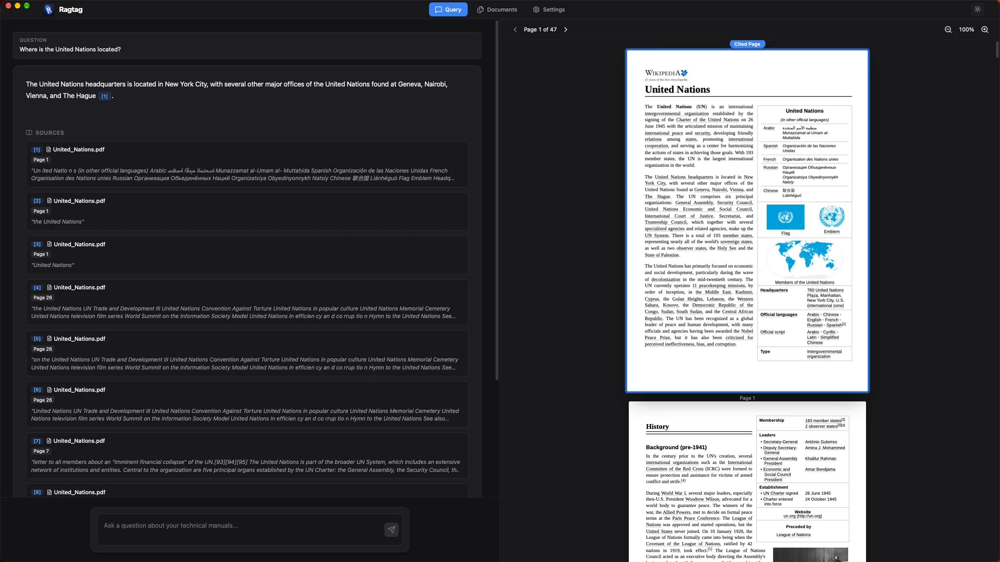
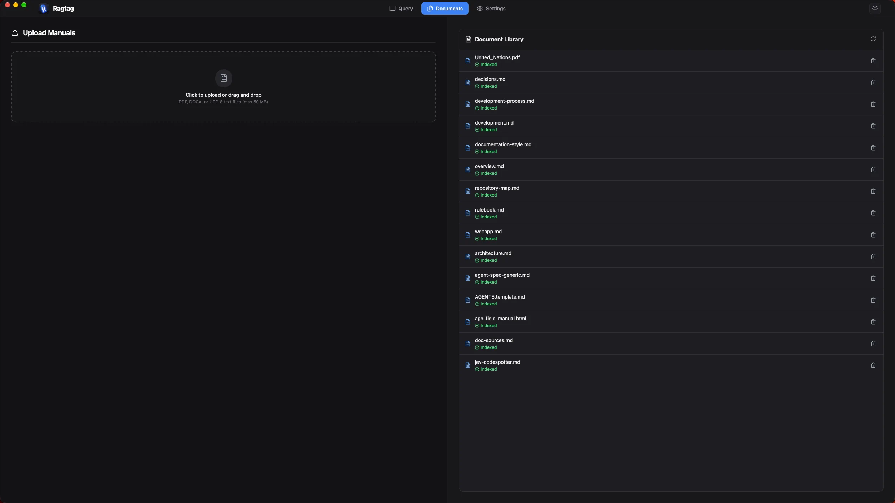
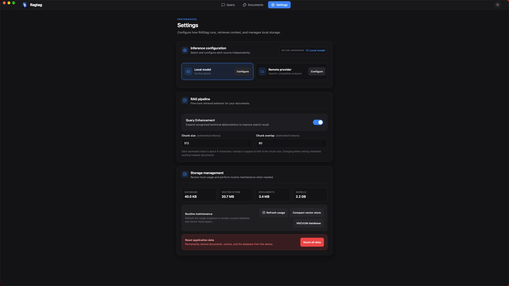

# Ragtag

Ragtag is a local-first desktop application for asking questions about PDFs, DOCX documents, and UTF-8 text files. It retrieves excerpts from your documents and streams answers with clickable source and page citations.

This is an **experimental, source-only project**, developed to demonstrate RAG workflows. No installer or binary release is provided. Supported development target: **Apple Silicon, macOS 15 or later**. Windows, Linux, and Intel Macs are not qualified.

## Features

- Local document extraction, tokenizer-aware chunking, and 768-dimensional EmbeddingGemma embeddings.
- Embedded SQLite registry and LanceDB hybrid full-text/vector retrieval.
- In-process local generation with `mistral.rs`; no local model server required.
- Optional OpenAI-compatible inference, including local providers such as Ollama and LM Studio.
- Streaming answers, request cancellation, and source previews.
- Retained original documents and recovery of interrupted indexing.

## Screenshots








## Run from source

### Requirements

- Apple Silicon Mac running macOS 15+.
- Node.js 24 and npm; `.nvmrc` selects the supported Node major.
- Rust 1.100.0 through [rustup](https://rustup.rs/); `rust-toolchain.toml` pins the compiler.
- Full Xcode, its command-line tools, and the Metal Toolchain.
- Protobuf (`protoc`), [Task](https://taskfile.dev/), and Tauri CLI v2.
- Internet access for dependency installation and first-run model downloads. Allow several GB of free disk space for model caches; Rust build artifacts require additional space.

For Homebrew users:

```sh
brew install node@24 protobuf go-task
cargo install tauri-cli --version 2.12.6 --locked
xcodebuild -downloadComponent MetalToolchain
```

Make sure Node.js 24 and the selected Xcode tools are on your PATH before continuing.

```sh
git clone https://github.com/MRKups/ragtag.git
cd ragtag
task setup
task dev
```

The embedder and default generation model download on first use. Document uploads unlock when the embedder is ready; local queries also require the generation model. The default generation model is `unsloth/Qwen3-1.7B-GGUF` / `Qwen3-1.7B-Q4_K_M.gguf`, with tokenizer assets from `Qwen/Qwen3-1.7B`. Model settings are configurable.

### Checks

```sh
npm run check
npm run build
npm test
npm run check:release
```

`npm test` includes frontend regressions, Rust workspace tests, and the vendored inference-engine regression. Native tests require the Metal tools. After dependency changes, regenerate the license inventory with `npm run licenses:generate`.

## Privacy and limitations

- Documents, indexes, model caches, and default inference stay on your machine. Model downloads contact their upstream hosts.
- External inference is opt-in: queries and retrieved excerpts are sent to the configured provider. HTTP endpoints are supported for local servers; use HTTPS for remote providers, especially when sending credentials.
- API keys use the OS keychain by default. If keychain services are unavailable, Ragtag falls back to **unencrypted SQLite storage** and shows a warning.
- PDFs need extractable text; OCR is not included. PDF citations preserve physical pages. DOCX and text sources use one logical page.
- Uploads are limited to 50 MiB; text and extracted content have additional indexing limits.
- Answers can be wrong even when they include citations. Inspect the original evidence, especially for technical or safety-critical use.
- Memory needs vary by model. See the [active tracker](docs/tracker.md) for unresolved reliability and qualification work.

## Documentation

Start with the [documentation index](docs/README.md), [architecture](docs/app-architecture.md), and [source-publication checklist](docs/open-source-readiness.md).

The application icon is the blue luggage tag with a white “R” on a dark rounded square. `assets/rt-logo.png` is the 1024-pixel source; native icons live in `src-tauri/icons/`.

## License

[MIT](LICENSE) for first-party software. See [third-party notices](THIRD_PARTY_NOTICES.md) for dependencies and the vendored engine. Downloaded model weights and tokenizers retain their upstream licenses and terms.
