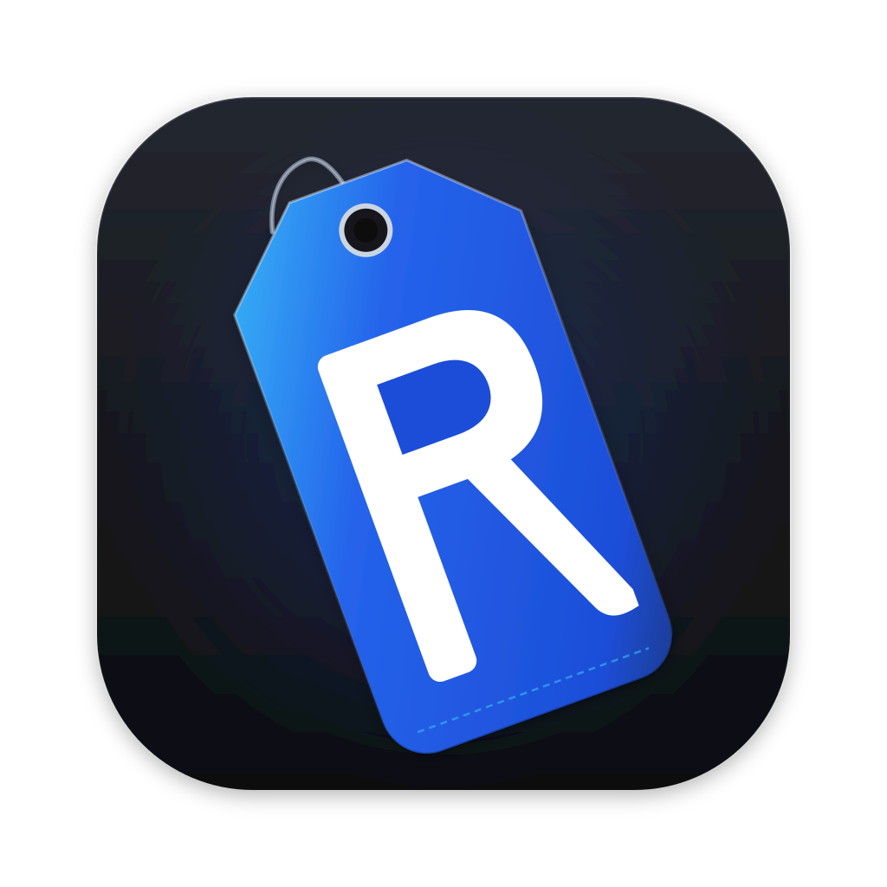
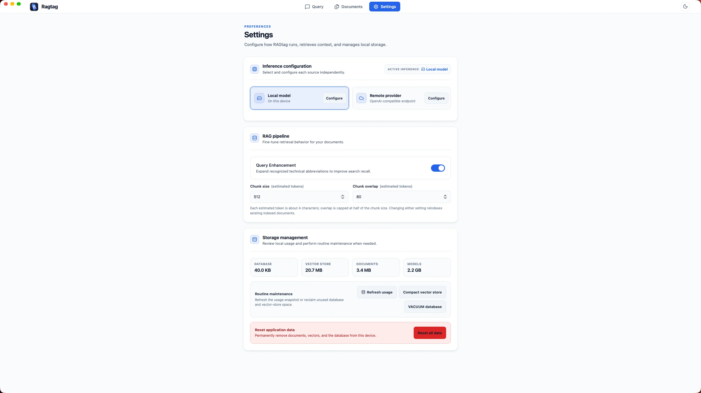

# Ragtag

Ragtag is a retrieval-augmented generation (RAG) application I use to demonstrate potential applications of RAG technology to clients.

It allows you to ask questions about PDFs, text documents, and other files. It runs locally and returns answers with page citations.

Source-only. Tested primarily on Apple Silicon. macOS 15+ or later.

## Screenshots




## Run from source

Requires Node.js 24, Rust 1.100.0, Xcode with Metal tools, Protobuf, Tauri CLI v2, and [Task](https://taskfile.dev/).

```sh
task setup
task dev
```

Models download on first use.

## License

[MIT](LICENSE). See [third-party notices](THIRD_PARTY_NOTICES.md) for dependencies.

## Acknowledgements

Special thanks to [Mackup.io](https://mackup.io/) for supporting this project.
