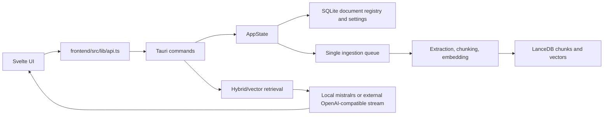

# Code Review — 2026-09-11

## Scope and method

Code-first review of the Rust workspace, Tauri application, Svelte frontend, configuration, migrations, and executable tests. The remediation below was implemented after the review; repository design documents were used only to update settled contracts.

## Executable architecture map

- **Frontend.** `App.svelte` loads persisted settings, installs application listeners, then enters the hash-routed query/documents/settings UI. `api.ts` is the sole Tauri boundary. Typed `Channel<T>` callbacks carry ingestion progress and streamed query tokens; lifecycle events refresh document and model state. The query path renders sanitized generated Markdown and exposes only citations returned by retrieval. PDF citation previews use Tauri's asset protocol; text and DOCX previews are supplied as typed blocks over IPC.
- **Tauri composition.** `src-tauri/src/lib.rs` owns startup, data-directory setup, model initialization, commands, request cancellation, recovery, and the single ingestion worker. It keeps the SQLite pool, LanceDB connection, embedder, optional local model, request cancellation map, and operation locks in `AppState`.
- **Ingestion.** Upload validates a size/type envelope, persists the original bytes to app-local storage, creates a queued SQLite document record, and tries to enqueue work. The worker marks a document embedding, extracts pages in a blocking task, chunks by the Embedder tokenizer, embeds batched `passage:` inputs, replaces that document's vectors, then marks its registry row indexed. Startup requeues interrupted, failed-within-budget, and provenance-stale documents after the embedder is ready.
- **Storage.** SQLite owns document identity/status/settings; migrations add indexing provenance. LanceDB stores derived vectors keyed by `(document_id, page, chunk_index)`, serializes writes, creates FTS and sufficiently-large IVF-PQ indexes, and searches only SQLite-indexed document IDs.
- **Querying.** The command embeds a query (`query:` prefix), performs hybrid retrieval with vector-only fallback, rehydrates document metadata from SQLite, constructs retrieval-grounded citations and context, then selects local `mistralrs` or configured external SSE inference. Terminal token events contain the retrieved citation list.
- **Inference configuration.** Local model downloads/builds are generation-tracked so stale initialization results are not installed. External mode probes `/models`, validates that the configured model exists, and reads the optional secret from the OS keychain.

## Remediated findings

- **DOCX decompression bound.** Indexing rejects `word/document.xml` over 16 MiB using both the ZIP-declared size and a streamed decompressed-byte cap.
- **Markdown structural bound.** Preview conversion caps recursive block and inline nesting at 32 levels, flattening deeper content to safe text; tight-list item text is retained as typed paragraphs.
- **Interrupted upload recovery.** Startup removes only unregistered direct regular files with a canonical UUID v7 managed-source name; registered documents, directories, and unrelated files remain untouched.
- **Terminal progress authority.** Terminal document lifecycle events finalize a progress ID before durable refresh; later request-channel callbacks for that ID are discarded. Silent document-list polling failures reschedule while transient rows remain.
- **Inference mode no-op.** The active mode is ignored in both the settings card and IPC command, avoiding redundant local-model or external-readiness restarts.
- **Rejected settings rollback.** The settings singleton restores the last persisted bound value after a failed write.
- **Upload-target stability.** Uploads snapshot stable row IDs and file references; file-list/drop mutations are disabled while uploads await IPC, so status updates cannot target a shifted row.
- **Chunk-setting disclosure.** The UI now states that either chunk setting reindexes existing indexed documents and retains the half-chunk overlap cap.
- **Concurrent duplicate typing.** Only SQLite `documents.file_hash` uniqueness violations map to `DuplicateDocument`; unrelated constraints remain typed database errors.

## Environment note — Intel macOS pipeline tests

This host uses the Taskfile-compatible external ONNX Runtime at `~/.cache/mrk-ragtag/onnxruntime-1.28.0/build/MacOS/Release`, with dynamic linking and an rpath. Cold native dependency builds exceeded the 600-second command limit several times; resumed builds completed and executed both Rust test suites.

## Validation

- `npm --prefix frontend run test:state` — passed, including terminal-progress and rejected-settings rollback regressions.
- `npm --prefix frontend run test:errors` — passed.
- `npm --prefix frontend run check` — passed: 0 errors, 0 warnings.
- `npm --prefix frontend run build` — passed; Vite reported its existing >500 kB chunk-size advisory.
- `cargo test -p persistence` — passed: 8 tests.
- `cargo test -p rag_pipeline` — passed: 19 tests under the Intel ONNX Runtime environment.
- `cargo test -p mrk-ragtag-app` — passed: 20 tests under the Intel ONNX Runtime environment.
- `cargo fmt --check` — passed.
